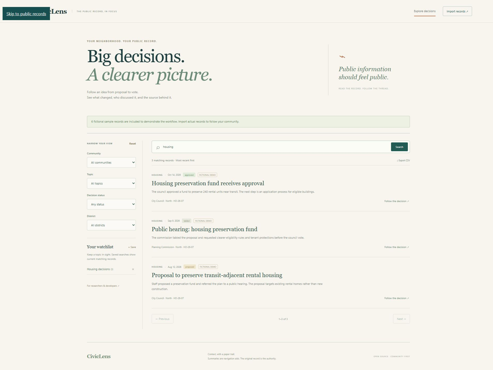

# CivicLens

[](https://github.com/hrushikbarani-hub/civiclens/actions/workflows/test.yml)

**Big decisions. A clearer picture.** A source-linked tracker for the local decisions that often disappear into meeting packets.

A housing proposal can pass through a council introduction, a planning hearing, and a final vote. CivicLens connects those observations into a chronological path while preserving the source excerpt, summary method, and revision history behind each record.



## What works today

- Search words across titles, summaries, source excerpts, and decision references; combine topic, status, district, and community filters.
- Follow a decision across meetings using its reference and jurisdiction.
- Read source excerpts beside clearly identified human, extractive, or fictional summaries.
- Import validated JSON bundles atomically. Repeat imports are idempotent; changed agenda items retain earlier revisions.
- Save searches to a watchlist with current match counts, and export filtered results to CSV.
- Convert a meeting agenda CSV into a validated bundle using the CLI.

Python/FastAPI serves the API, plain JavaScript runs the interface, and SQLite keeps the records in your workspace. There are no required hosted services or model keys.

## Quick start

Requires Python 3.11+. From this repository:

```sh
python -m venv .venv
# Windows: .venv\Scripts\activate
# macOS/Linux: source .venv/bin/activate
python -m pip install -e ".[dev]"
python -m uvicorn civiclens.main:app --host 127.0.0.1 --port 8002
```

Open [localhost:8002](http://localhost:8002). API documentation is at `/docs`. On Windows, `./run.ps1` installs and launches; use `-Python 'C:\path\to\python.exe'` if needed, or `-SetupOnly` to only install.

Or run `docker compose up --build`. Compose binds port 8002 on the local computer and uses a named database volume. Docker builds are checked in CI.

## Explore the demonstration

The initial six records describe **fictional Sample City decisions**, labeled throughout the UI and linked to reserved `example.invalid` URLs. Search `housing` and open the approved preservation fund to see its three-meeting path. Save that search to a watchlist, then reload.

CivicLens ships no real municipal dataset. It does not crawl websites, infer vote outcomes, or generate AI summaries. Imported summaries and statuses should be checked against their original records. Watchlists are saved queries with live counts; email alerts are a future feature.

## Bring your community's records

Select **Import records** and download the example JSON bundle. Replace the fictional values, set the meeting's `is_demo` to `false`, and provide a source excerpt for every item. Upload the resulting JSON file (browser limit: 2 MB).

For an agenda CSV, begin with [examples/agenda.csv](examples/agenda.csv). Each row requires `id,title,summary,source_excerpt,topic,status,source_url`; optional columns include `district,reference,summary_method`. One conversion corresponds to one meeting:

```sh
python -m civiclens.cli convert-csv examples/agenda.csv --meeting-id sample-session --date 2026-10-14 --body "City Council" --title "Sample session" --jurisdiction "Sample City" --source-url https://example.invalid/meeting --demo
```

This prints validated JSON to stdout. Save it as UTF-8 and then:

```sh
python -m civiclens.cli validate bundle.json
python -m civiclens.cli import bundle.json
```

An installed `civiclens` command has the same interface. Import accepts `--db path/to/file.sqlite3`. Exit codes are 0 success and 2 invalid data/read failure. Standalone validation requires referenced meetings in the same file; database imports can also reference previously imported meetings.

Use stable IDs. A repeated item ID updates that observation and creates a revision when its content changes. A new meeting observation needs a new item ID and the **same decision reference** to join the timeline. Namespace IDs by community and meeting to prevent accidental cross-community updates. Timelines match exact references within one jurisdiction and demo/real classification; unrelated decisions are not matched by title similarity.

## Configuration

| Variable | Default | Purpose |
| --- | --- | --- |
| `CIVICLENS_DB` | `data/civiclens.sqlite3` | SQLite file path |
| `DEMO_DATA` | `1` | Seed fictional records only if the database is empty |
| `WRITE_TOKEN` | empty | Require `X-Write-Token` for imports and watchlist writes |

Use `.env.example` with Docker Compose or Uvicorn's `--env-file .env`. Disabling demo data only prevents seeding; choose a new database to start without existing samples.

This is a shared local workspace. Before public hosting, set a write token, put access control and HTTPS at a reverse proxy, and configure request/body limits. Everyone with read access can see all imported records and saved searches; there are no private user workspaces. Import only records appropriate for that audience.

## Development

```sh
python -m pytest -q
python -m ruff check .
python -m ruff format --check .
python -m build
```

Tests cover transactional imports, persistence, revisions, reference isolation, search, watchlists, write protection, CSV escaping, and conversion. Read [architecture](docs/architecture.md), [contributing](CONTRIBUTING.md), and [roadmap](docs/roadmap.md). MIT licensed.
